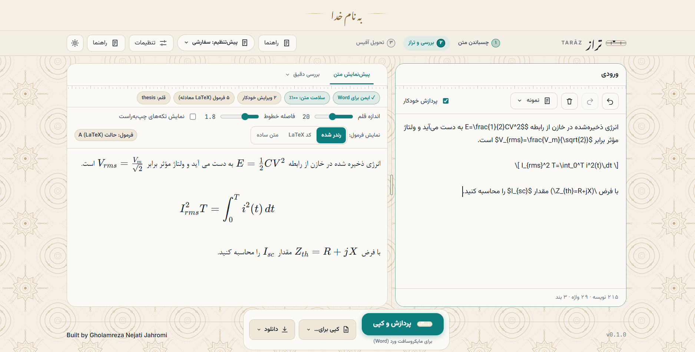

<div align="center">

# تراز · Tarāz

### متن فارسی–انگلیسی‌ات را پیش از رسیدن به Word، مرتب کن

ابزاری سبک و رایگان که در مرورگر اجرا می‌شود؛ بدون نصب، بدون ثبت‌نام.

<br>



</div>

<br>

## ماجرا از کجا شروع شد؟

یک پاسخ خوب از ChatGPT یا Claude می‌گیری، کپی می‌کنی، در PowerPoint / Word می‌چسبانی… و همه‌چیز به‌هم می‌ریزد.
جملهٔ دوزبانه‌ات وارونه نمایش داده می‌شود، «می‌خواهم» می‌شود «می خواهم»، پرانتزها جای خود را عوض می‌کنند، و فرمول‌های LaTeX مثل متن خام و نامفهوم وسط پاراگراف می‌مانند.

تراز برای همین ساخته شد. اول برای رفع دردسر خودم، چون پایان‌نامه و مقاله‌هایم پر از متن فارسی و اصطلاح انگلیسی و فرمول بود؛ و بعد دیدم به درد هر کسی می‌خورد که با ترکیب فارسی و انگلیسی کار می‌کند.

متنت را می‌چسبانی، تراز مرتبش می‌کند، و با یک کلیک تحویل Word می‌دهد.

<br>

## یک نگاه سریع: قبل و بعد

| قبل از تراز | بعد از تراز |
|---|---|
| می خواهم کتاب ها را بخوانم | می‌خواهم کتاب‌ها را بخوانم |
| نرم افزار و بهره برداری | نرم‌افزار و بهره‌برداری |
| تعداد 1000000 نفر در سال 1403 | تعداد ۱۰۰۰۰۰۰ نفر در سال ۱۴۰۳ |
| طبق استاندارد IEEE 1547 | طبق استاندارد IEEE 1547 (دست‌نخورده و با جهت درست) |
| معادلهٔ `$x^2 + y^2 = r^2$` به‌صورت متن خام | معادلهٔ بومی Word (OMML) در فایل `.docx` |

<br>

## تراز چه کارهایی می‌کند؟

**🧭 جهت متن را درست نگه می‌دارد.**
هر پاراگراف و هر تکهٔ انگلیسی جداگانه بررسی می‌شود. ترتیب منطقی جمله دست نمی‌خورد و پاراگراف‌های دوزبانه نمی‌شکنند.

**🧹 نویسه‌های نامرئی خطرناک را پاک می‌کند.**
بعضی کاراکترهای پنهان که از چت‌بات‌ها می‌آیند، در Word و PowerPoint به‌شکل مربع‌های خالی دیده می‌شوند. تراز پیدا و حذفشان می‌کند.

**✍️ نیم‌فاصله را درست می‌گذارد.**
«می‌روم»، «کتاب‌ها»، «نرم‌افزار»، «بهره‌برداری» و ترکیب‌های رایج دیگر. با فهرست استثنای قابل‌تنظیم، برای وقتی که خودت می‌دانی بهتر است.

**🔢 اعداد را آن‌طور که می‌خواهی نشان می‌دهد.**
فارسی، انگلیسی، یا بدون تغییر؛ و برای متن، عنوان، جدول، لیست و عبارت‌های فنی جداگانه. شناسه‌هایی مثل `IEEE 1547`، نشانی وب و مسیر فایل دست‌نخورده می‌مانند.

**❝ ❞ نشانه‌گذاری فارسی را مرتب می‌کند.**
فاصله‌گذاری ، ؛ ؟ و پرانتز و گیومه، سه‌نقطه، درصد و خط‌تیره.

**∑ فرمول‌های LaTeX را به معادلهٔ Word تبدیل می‌کند.**
خروجی معادلهٔ بومی Word (OMML) است، نه عکس و نه متن خام. اگر ترجیح می‌دهی، متن خطی ساده هم می‌گیری.

**📝 Markdown را می‌فهمد.**
عنوان، لیست، جدول، نقل‌قول، کد و پیوند، همه به ساختار واقعی Word تبدیل می‌شوند.

**📤 هر خروجی که لازم داری.**
کپی مستقیم برای Word و PowerPoint، یا دانلود فایل `.docx` و `.html` و `.md` و `.txt`.

**🎛️ پیش‌تنظیم‌های آماده.**
پایان‌نامه، گزارش فنی، اسلاید، ایمیل، چت، یا «حداقل تغییر» برای وقتی که فقط می‌خواهی مشکلات جدی رفع شود.

**🔍 ببین چه تغییری داده شده.**
نمای مقایسهٔ تغییرات، نمای جهت تکه‌ها و گزارش ایمنی آفیس به تو اجازه می‌دهند همه‌چیز را قبل از کپی بررسی کنی.

<br>

## چطور استفاده کنم؟

سه قدم ساده:

1. **بچسبان:** متن را در برگهٔ ورودی بگذار.
2. **ببین:** نتیجه همان لحظه در پیش‌نمایش ظاهر می‌شود. اگر چیزی را نپسندیدی، از تنظیمات عوضش کن.
3. **تحویل بده:** دکمهٔ «پردازش و کپی» (یا `Ctrl+Enter`) را بزن و در Word با `Ctrl+V` بچسبان.

### اجرا روی کامپیوتر خودت

۱. این مخزن را دانلود کن: روی دکمهٔ سبز **Code** و بعد **Download ZIP** بزن، یا با Git:

```bash
git clone https://github.com/njt138/Taraz.git
```

۲. فایل **`TARAZ.html`** را با Chrome یا Edge باز کن. همین! نیازی به سرور یا نصب چیزی نیست.

<br>

## دربارهٔ اینترنت و حریم خصوصی

**متن تو هیچ‌وقت از مرورگرت بیرون نمی‌رود.** همهٔ پردازش‌ها روی دستگاه خودت انجام می‌شود، و برنامه هیچ متنی را ذخیره یا ارسال نمی‌کند. فقط تنظیمات انتخابی تو در حافظهٔ مرورگر می‌ماند.

با این حال، برای راحتی کار، چند منبع آماده از اینترنت بارگذاری می‌شود:

| چه چیزی | برای چه کاری | اگر اینترنت نباشد |
|---|---|---|
| Google Fonts | قلم‌های زیبای رابط (مثل Vazirmatn) | قلم‌های خود سیستم جایگزین می‌شوند |
| KaTeX | نمایش زیبای فرمول‌ها در پیش‌نمایش | فرمول به‌صورت کد LaTeX دیده می‌شود |
| docx و JSZip | ساخت فایل `.docx` | دانلود `.docx` کار نمی‌کند، ولی کپی برای Word و بقیهٔ خروجی‌ها کار می‌کنند |

درخواست این منابع فقط نشانی IP تو را به آن سرویس‌ها نشان می‌دهد، نه متنت را.

<br>

## محدودیت‌های فعلی

تراز هنوز نسخهٔ اول است و صادقانه بگویم:

- برای Chrome و Edge طراحی شده؛ مرورگرهای دیگر را آزمایش نکرده‌ام.
- فرمول‌ها برای Microsoft Word ساخته می‌شوند. LibreOffice و Google Docs ممکن است آن‌ها را متفاوت نشان بدهند یا نشان ندهند.
- اعداد اعشاری به‌طور پیش‌فرض با «.» می‌مانند. اگر جداکنندهٔ فارسی «٫» را می‌خواهی، از تنظیمات تغییرش بده.
- تبدیل `--` به خط‌تیره ممکن است روی پرچم‌های خط فرمان (مثل `--verbose`) هم اثر بگذارد. اگر متن فنی داری، آن‌ها را داخل بک‌تیک (`` ` ``) بگذار تا دست‌نخورده بمانند.

اگر به مشکلی برخوردی، خوشحال می‌شوم بدانم. بخش بعدی را ببین.

<br>

## گزارش اشکال و پیشنهاد

از بخش **Issues** همین مخزن یک موضوع جدید باز کن و بنویس:

- چه متنی را چسباندی (اگر خصوصی نیست)،
- چه نتیجه‌ای گرفتی،
- و انتظار داشتی چه چیزی ببینی.

هر پیشنهاد و گزارشی کمک بزرگی است.

<br>

## ساختار پروژه

برای کسانی که می‌خواهند کد را بخوانند:

```
TARAZ.html        نقطهٔ ورود برنامه
css/              سبک‌ها
js/core/          ثبت ماژول‌ها، تنظیمات و ترجمه‌ها
js/engine/        موتور پردازش متن: جهت، نیم‌فاصله، ارقام، نشانه‌گذاری، ایمنی
js/math/          تشخیص و پاک‌سازی LaTeX
js/output/        خروجی‌ها: کلیپ‌بورد، docx، OMML، html
js/ui/            رابط کاربری
```

بدون npm، بدون فریم‌ورک، بدون ابزار ساخت. فقط HTML و CSS و جاوااسکریپت ساده.

<br>

## لایسنس

<!-- TODO: پس از انتخاب لایسنس، نام آن را اینجا بنویس و فایل LICENSE را به مخزن اضافه کن. -->

جزئیات در فایل [LICENSE](LICENSE).

<br>

---

<div align="center">

ساخته‌شده با ❤️ توسط **Gholamreza Nejati Jahromi**

اگر تراز به کارت آمد، با ⭐ دادن به این مخزن خوشحالم می‌کنی.

</div>
